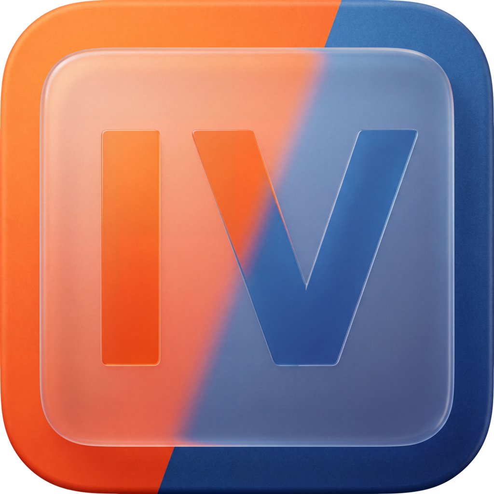

# ImageViewer



**An image viewer you can trust.** ImageViewer shows every image as its file defines it, in SDR and HDR, on Windows, macOS and Linux, and proves it: the colors it puts on screen are tested against the standards on every build.

- **One conversion, done right.** Each image is converted once, from its own color description (ICC v2/v4 profile, CICP code points or EXR chromaticities), into a linear wide-gamut working space at 16-bit floating point. Nothing is quantized below that before the display; wide-gamut colors are kept, not clipped to sRGB.
- **Real HDR.** Where the system has an HDR output (scRGB on Windows, EDR on macOS, HDR10), ImageViewer uses it: PQ content keeps its absolute luminance, HLG gets the BT.2100 system gamma. Highlights brighter than the display are tone mapped with ITU-R BT.2390, or clipped on request, and the viewer always says which; it can mark every pixel it had to alter.
- **Professional formats.** 134 file name extensions, recognized by their content rather than their name: JPEG, JPEG XL, PNG, TIFF, WebP, AVIF, OpenEXR, DPX, Cineon, Radiance HDR, camera RAW, and a long tail read in a separate process so that a damaged file cannot take the viewer down.
- **Out of the way.** The image fills the window; the rest is a key, a click on the window's sides, the gallery or the right-click menu away, in 37 languages.

> Status: **0.9**. The color pipeline, HDR output, format coverage and the viewer are in place and tested on every build; installers, signed packages and a pixel value readout come next. The [plan](docs/PLAN.md) has the details.

## Download

Get the latest version from [Releases](https://github.com/njardim/ImageViewer/releases):

| System | Package | Requirements |
|---|---|---|
| Windows x64 | `ImageViewer-<version>-windows-x64.zip` — unzip and run `bin/ImageViewer.exe` | Windows 10 (22H2) or 11 |
| macOS (Apple silicon) | `ImageViewer-<version>-macos-arm64.dmg` — drag `ImageViewer.app` to Applications | macOS 14.4 or later |
| Linux x64 | `ImageViewer-<version>-linux-x64.tar.gz` — extract and run `bin/ImageViewer` | glibc 2.39 (Ubuntu 24.04 or newer distributions), X11 or XWayland, `libopengl0`, `libegl1`, `libxcb-cursor0` |

`SHA256SUMS` lists the checksums of the packages. Each package is built and tested by CI on a clean machine, and on public releases it carries a GitHub build provenance attestation (`gh attestation verify <file> --repo njardim/ImageViewer`).

The packages are **not signed yet**:
- **Windows:** SmartScreen asks for confirmation. Choose *More info → Run anyway*.
- **macOS:** Gatekeeper blocks the first launch. Open *System Settings → Privacy & Security* and choose *Open Anyway*.

## Features

- **Color management:** ICC v2 and v4 profiles (LittleCMS, or an exact matrix/curve path), CICP (BT.709, BT.2020, Display P3; sRGB, BT.1886, gamma, linear, PQ, HLG; narrow or full range) with priority over an embedded ICC, OpenImageIO's color spaces (ACES included) and EXR chromaticities; 8- and 16-bit integer and 16/32-bit floating-point images; alpha composited in linear light.
- **HDR:** scRGB (Windows), EDR (macOS) and HDR10/PQ output; PQ in absolute nits; BT.2390 tone mapping only when an image exceeds the display, exposure in half stops, and a highlight for clipped or tone-mapped pixels.
- **Formats:** JPEG, JPEG XL, PNG and APNG, TIFF, WebP, AVIF, GIF, JPEG 2000, OpenEXR, DPX, Cineon, PFM, Radiance HDR, BMP, TGA, PSD (composite), DDS, FITS, camera RAW (LibRaw) and more. GIMP XCF, PCX, Apple PICT, MIFF, DICOM and other rare formats are read by GraphicsMagick in a separate process with a list of allowed decoders, limits and a time-out. SVG and SVGZ are drawn by resvg, in a separate process too, with filters, masks, clip paths, CSS and text, and nothing outside the file is ever read. *Settings → Image Formats* (or `ImageViewer --formats`) lists every extension with its decoder and version. HEIC is decoded by the operating system (macOS; Windows with Microsoft's HEIF and HEVC extensions); ImageViewer ships no HEVC decoder.
- **Animation:** GIF, WebP, APNG, JPEG XL and AVIF sequences play with their own timing and loop count; pause and step frame by frame.
- **Viewing:** zoom at the cursor and an exact 100 % (one image pixel per screen pixel); fit to the window, its width or its height, fill it, or actual size, a mode that stays for the next images, and Lock Zoom to keep any zoom; rotate and mirror; full screen; a checkerboard behind transparent areas; the window can take the size of the image.
- **Gallery:** the folder's thumbnails along the bottom (G), small, medium or large, optionally the one under the pointer enlarged, the current one on a highlight color of your choice; a click shows an image, the wheel scrolls.
- **Slideshow:** through the folder at the pace you set, optionally in full screen, with its own toolbar (stop, pause and play) that can hide while the pointer is still.
- **Information:** a compact line at the top (I) with the fields you choose; a panel (P) with everything about the file, the image, its color, its peak luminance, the camera (EXIF), the view and the output; neither ever moves the image, and both stay legible over any image, in SDR and HDR.
- **Navigation:** folders sorted by name (natural order), date or size; previous and next by keyboard, mouse side buttons or the window's sides; the neighbours loaded in advance; the folder watched, so files changed by other programs show up at once; optional looping.
- **Files:** copy the image (16-bit) or its path, rename, move to the trash and undo, delete permanently, recent files, show in the file manager, open with another application.
- **Settings:** with Apply, for everything above, including every keyboard shortcut and the size of the interface's text.
- **Our icons on every system:** the same icons on Windows, macOS and Linux, in each system's own windows and controls, light or dark as the system is.
- **37 languages:** English, the most spoken languages (简体中文, हिन्दी, Español, العربية, Français, বাংলা, Português, Bahasa Indonesia, اردو, Русский, Deutsch, 日本語, मराठी, Tiếng Việt, తెలుగు), 한국어, Italiano, Türkçe and every official language of the European Union. All but English are machine translations awaiting review by native speakers; [corrections are welcome](CONTRIBUTING.md#translations).

## Using it

`ImageViewer [file or folder]`, drag and drop, O, or *Open* from the right-click menu.

| Key | Action |
|---|---|
| ← → (or click the window's sides) | Previous / next image |
| Shift+← / Shift+→ (or Home / End) | First / last image |
| + / − / mouse wheel | Zoom |
| 0 / 1 | Fit to window / actual size (100 %) |
| W / H | Fit to width / height |
| X | Fill the window |
| G | Gallery: the folder's thumbnails at the bottom |
| Z | Lock the zoom for the next images |
| F, F11, double-click | Full screen |
| R / Shift+R | Rotate clockwise / counterclockwise |
| Shift+W / Shift+H | Mirror horizontally / vertically |
| I / P | Information overlay at the top / information panel |
| B | Checkerboard behind transparent areas |
| Space / Ctrl+← / Ctrl+→ (⌘ on macOS) | Pause the running slideshow, otherwise the animation / previous frame / next frame |
| S / Esc | Start or stop the slideshow / stop it (or its toolbar's buttons) |
| E / Shift+E / Ctrl+E | Exposure +½ / −½ EV / reset |
| T | Tone mapping on/off (off: clip at the display's peak) |
| C | Highlight altered (clipped or tone-mapped) pixels |
| Ctrl+C / Ctrl+Shift+C | Copy image / copy file path |
| F2 or Return | Rename |
| Delete (⌘⌫ on macOS) / Ctrl+Z | Move to the trash / undo |
| Shift+Delete (⌘⇧⌫ on macOS) | Delete permanently |
| O / Shift+O | Open a file / open it with another application |
| M | Minimize the window |
| Ctrl+, | Settings |
| V | About ImageViewer |
| Q (or Ctrl+Q) | Quit |
| Right-click | Menu with every command |

On macOS, Ctrl is ⌘. Every shortcut can be changed in *Settings → Shortcuts*. The defaults follow one rule: single keys view, navigate and open, Shift + a key does that key's other command, ⌘/Ctrl does the application's other commands; none needs the fn key of a MacBook.

## How fidelity is verified

Every change is built and tested on Windows, macOS and Linux; the on-screen and interaction tests need a display server and run on Linux (Xvfb, with Vulkan and OpenGL). The references are the standards themselves, computed independently in the tests, never the viewer's own code.
- **PQ and HLG:** ramps from 0 to 10,000 nits in BT.2020, as 16-bit PNG (cICP), JPEG XL and 12-bit AVIF, are decoded and drawn, and the GPU's output is compared with SMPTE ST 2084 and ITU-R BT.2100: within 0.1 %, in absolute nits on a PQ display.
- **Output stage:** the GPU output is read back for SDR, EDR, scRGB and HDR10, with and without tone mapping, and compared with a CPU reference and with BT.2390 computed independently: identity below the knee, the content peak on the display peak, monotonic output, hues preserved.
- **On screen:** an 8-bit image shown at 100 % must be identical to the file, bit for bit.
- **Decoding:** a Display P3 red keeps its value outside sRGB, an EXR its values above SDR white, a 16-bit JPEG XL all 16 bits; every format with a test file decodes it exactly; every frame of the test animations has the right color and duration. The same tests run again on the packaged application on a clean machine.
- **Damaged files:** every test file, corrupted a dozen ways, must decode or fail cleanly within a time limit.
- **Interaction:** a simulated user clicks the window's sides, flips and rotates the image (compared pixel for pixel), uses the trash and its undo, renames, deletes, watches files change underneath, uses the gallery, the slideshow and its toolbar, the zoom modes and the settings, and quits with the session saved. On macOS, quitting from the application menu is tested too.

[`docs/PLAN.md`](docs/PLAN.md) lists the fidelity criteria (§7), the decisions behind them (§2) and the test results (§1).

## Building from source

The dependencies are Qt 6.12 (official binaries) and OpenImageIO, LittleCMS, libjxl, libwebp, libheif, GraphicsMagick, resvg and their codecs (from vcpkg, using the manifest `vcpkg.json`). resvg, the SVG renderer, is built with Rust: rustup installs the version `packaging/vcpkg/ports/imageviewer-svg/rust-toolchain.toml` pins.

```
cmake --preset <windows|macos|linux> -DCMAKE_PREFIX_PATH=<Qt 6.12 directory>   # needs VCPKG_ROOT
cmake --build --preset <windows|macos|linux>
tests/smoke.sh <executable>
```

To develop on Linux without vcpkg, run `scripts/build-qt-linux.sh` (builds Qt from source) and `scripts/build-svg.sh` (the SVG renderer), and use the `linux-system` preset. `CLAUDE.md` describes the full test set and the rules for working on the code.

Command-line tools for diagnosis:
- `ImageViewer --info <file>` prints what the color pipeline sees.
- `ImageViewer --render <file> --output sdr|edr|scrgb|pq` draws the image off screen and compares the GPU with the CPU reference.

## Releases

Versions are numbered `X.Y` (for example 0.1, 0.2, 1.0), with an optional suffix such as `-beta`. Publishing a GitHub release named `vX.Y` builds, tests and attaches the three packages automatically; nobody builds release binaries by hand.

## Security

Every file is treated as hostile input. Dependencies are audited against known vulnerabilities by
the exact commit they are built from, release archives are checked against their source
repository, a new release of a library is taken only after a 15-day cooldown, and every release
carries attested provenance and a bill of materials for each package. To report a
vulnerability, see [`SECURITY.md`](SECURITY.md) (privately, never in a public issue).

## Contributing

Contributions are welcome, including translations; see [`CONTRIBUTING.md`](CONTRIBUTING.md). Commits need a [Developer Certificate of Origin](https://developercertificate.org/) sign-off (`git commit -s`).

## License

[Apache License 2.0](LICENSE). See [`NOTICE`](NOTICE). The name and logo "Cristallumnis" are trademarks of Cristallumnis, Lda. and are not licensed under the Apache License. The packages include the licenses of the third-party components in their `third-party` folder.

© 2026 Cristallumnis, Lda.
